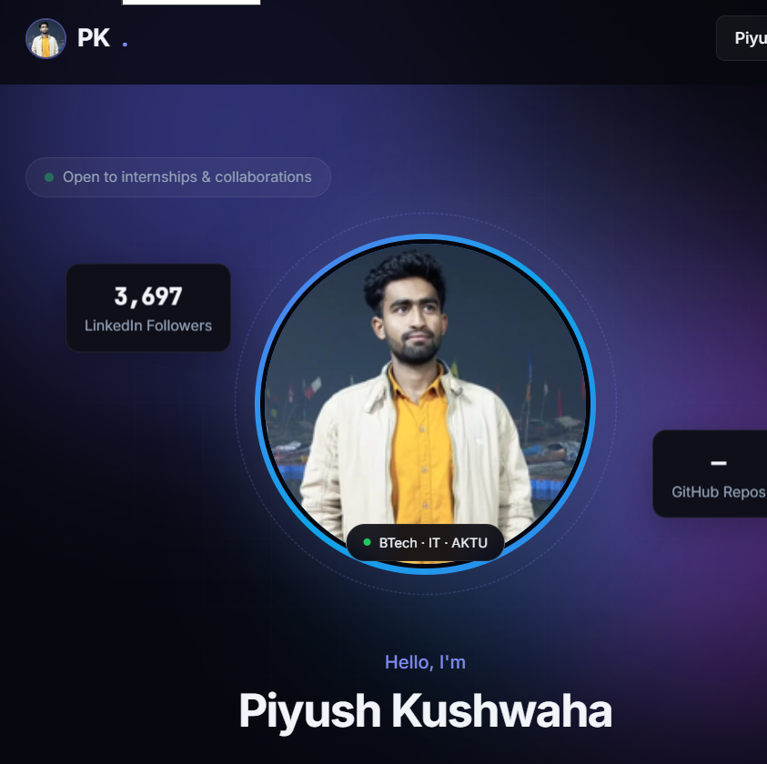

# Piyush Kushwaha · Portfolio Website 🚀

<div align="center">

  

  <h3><strong>Piyush Kushwaha</strong></h3>
  <p><strong>Aspiring Software Developer · 3rd Year BTech (IT) · Open Source Contributor</strong></p>

  <p align="center">
    <a href="https://www.linkedin.com/in/piyush-k-4302ba226/"></a>
    <a href="https://github.com/Pk1823"></a>
    <a href="https://leetcode.com/u/pk2428/"></a>
    <a href="https://codeforces.com/profile/contri25"></a>
  </p>

  <p>
    
    
    
    
  </p>

</div>

---

## 📌 Overview

A fast, interactive, and responsive developer portfolio built with **React** and **Vite**. Showcases hands-on technical projects, campus leadership roles, hackathon accolades, and real-time coding statistics fetched from **GitHub**, **LeetCode**, and **Codeforces**.

Designed with a sleek **dark-mode glassmorphic interface**, custom glow orbs, and fluid micro-interactions.

---

## ✨ Features & Sections

- 🌟 **Hero & Aurora Aesthetics:** Dynamic typing text animation, floating live statistic chips, and quick-scroll buttons.
- 🧑‍💻 **About Me:** Academic overview (AKTU / SAREC Mirzapur), core mindset, LinkedIn follower metric (5,000+), and algorithm tags.
- 💼 **Leadership & Experience:**
  - 🌐 **AWS Global University Program Campus Ambassador** — Driving cloud literacy, student community outreach, and AWS builder sessions.
  - 🏆 **Smart India Hackathon (SIH) Internal Hackathon Organising Team Member (2026)** — Coordinated campus hackathon logistics, registrations, and technical rounds.
  - 🎓 **Class Representative (Sept 2024 – Present)** — Department of Information Technology, facilitating student-faculty coordination and technical events for 300+ students.
- 🎖️ **Achievements & Verified Credentials:**
  - **Smart India Hackathon 2026** — Certificate of Appreciation from Ministry of Education / AICTE.
  - **Open Source Day (STIC x WikiClub Tech x GDG Prayagraj)** — Certificate of Appreciation & official Co-organiser Badge.
  - **FlowJam Hackathon 2026** — 3rd Position by FlutterFlow Developer Group Prayagraj.
  - **OpenCode'25** — Global Rank 65 by GeekHaven, IIIT Allahabad.
  - **GirlScript Summer of Code (GSSoC) 2026** — Contributor & Bounty Hunter badge.
  - **Open Source Connect Global (OSCG) 2026** — Contributor.
  - **Google Cloud Skills Boost** — Diamond League (15,860+ skill points) and verified skill badges (Generative AI, RAG, Cloud Run).
- 📈 **Real-time Live Stats Sync:** Live repository counts, LeetCode problem-solving rankings, and Codeforces contest metrics.
- 💻 **Featured Projects:**
  - **TNCC · SARECM** — College coding club portal with automated registration workflows.
  - **Setu · GDG On Campus** — AI-powered Academic Recall Assistant with Google Gemini & RAG.
- 📬 **Interactive Contact Portal:** Quick-copy handles and direct social connections.

---

## 🛠️ Tech Stack

| Domain | Technologies & Tools |
| :--- | :--- |
| **Frontend Core** | React 19, JavaScript (ESNext), HTML5, CSS3 |
| **Build Tool & Bundler** | Vite 8 |
| **UI Styling** | Modern CSS, CSS Variables, Glassmorphism, Responsive Grid / Flexbox |
| **APIs Integrated** | GitHub REST API, LeetCode GraphQL / REST Proxies, Codeforces API |
| **Fonts & Icons** | Plus Jakarta Sans, JetBrains Mono, Custom SVG Vector Icons |

---

## 📁 Project Structure

```bash
Piyush_portfolio_23-may/
├── public/
│   ├── images/
│   │   ├── certificates/      # Verified hackathon certificates & badge photos
│   │   │   ├── sih-certificate.jpg
│   │   │   ├── open-source-day-cert.jpg
│   │   │   └── ...
│   │   └── profile.png        # Profile portrait
│   ├── favicon.svg
│   └── icons.svg
├── src/
│   ├── assets/
│   ├── components/
│   │   ├── About.jsx          # Bio, stats overview & tech stack
│   │   ├── Achievements.jsx   # LinkedIn certs, hackathons & skill badges
│   │   ├── Contact.jsx        # Contact & profile connect cards
│   │   ├── Experience.jsx     # Campus ambassador, SIH organizing & CR
│   │   ├── Footer.jsx         # Footer copyright & links
│   │   ├── Hero.jsx           # Landing section with typing animation
│   │   ├── Marquee.jsx        # Infinite skill ticker
│   │   ├── Navbar.jsx         # Navigation bar with smooth scrolling
│   │   ├── Projects.jsx       # Featured work & GitHub repositories
│   │   ├── Stats.jsx          # Live LeetCode & Codeforces metric counters
│   │   └── TypingText.jsx     # Dynamic typing effect
│   ├── data/
│   │   ├── links.js           # Social & profile URLs
│   │   └── profile.js         # Profile constants, experiences & credentials
│   ├── hooks/
│   │   └── useProfileData.js  # Live stats fetching hook (GitHub/LeetCode/CF)
│   ├── App.jsx                # Root application layout
│   ├── index.css              # Global styles, variables & animations
│   └── main.jsx               # React DOM entry point
├── index.html
├── package.json
└── vite.config.js
```

---

## 🚀 Getting Started

Follow these steps to run the portfolio locally on your machine:

### Prerequisites

- [Node.js](https://nodejs.org/) (version 18.0.0 or higher recommended)
- [npm](https://www.npmjs.com/) (version 9 or higher)

### Installation

1. **Clone the repository:**
   ```bash
   git clone https://github.com/Pk1823/Piyush_portfolio_23-may.git
   cd Piyush_portfolio_23-may
   ```

2. **Install dependencies:**
   ```bash
   npm install
   ```

3. **Start the local development server:**
   ```bash
   npm run dev
   ```
   Open **[http://localhost:5173](http://localhost:5173)** in your browser.

4. **Build for production:**
   ```bash
   npm run build
   ```
   The production-ready assets will be compiled into the `dist/` directory.

---

## 📬 Connect with Me

- **LinkedIn:** [Piyush Kushwaha (5,000+ followers)](https://www.linkedin.com/in/piyush-k-4302ba226/)
- **GitHub:** [@Pk1823](https://github.com/Pk1823)
- **LeetCode:** [@pk2428](https://leetcode.com/u/pk2428/)
- **Codeforces:** [@contri25](https://codeforces.com/profile/contri25)
- **Google Cloud Skills:** [Cloud Skills Boost Profile](https://cloudskillsboost.google/public_profiles/72864a23-ae8a-456b-8f76-176d40d9441e)

---

<p align="center">
  Crafted with ❤️ by <strong>Piyush Kushwaha</strong>
</p>
